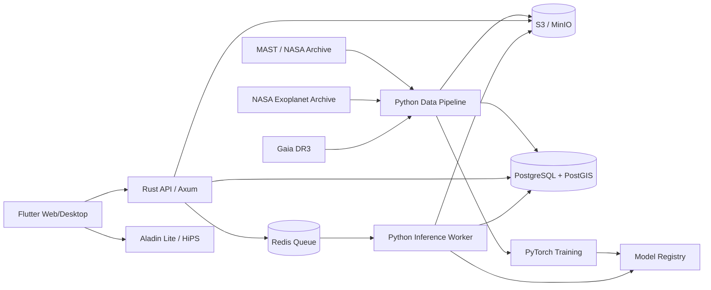

# AstroMap-AI - plan complet de realizare

## 1. Scopul documentului

Acest document transformă specificația inițială într-un plan tehnic și științific executabil pentru o teză de master. Soluția propusă folosește:

- **Python 3.11+** pentru achiziția datelor, procesarea astrofizică, antrenare și inferență GPU;
- **Rust** pentru API-ul public, orchestrarea joburilor, acces concurent la date și distribuirea artefactelor;
- **Flutter/Dart** pentru aplicația web și desktop de explorare și validare a candidaților;
- **PostgreSQL + PostGIS**, Redis și stocare de obiecte compatibilă S3 pentru persistență;
- containere Docker și un server NVIDIA/CUDA pentru reproducibilitate și deployment.

Obiectivul realist al tezei este demonstrarea unei metode reproductibile care clasifică semnale de tranzit și estimează parametri fizici, comparată riguros cu un baseline BLS. Platforma interactivă este instrumentul de inspecție și demonstrație, nu contribuția științifică principală.

## 2. Analiza critică a specificației inițiale

### 2.1 Puncte solide

- Problema este relevantă, măsurabilă și are surse publice de date.
- Combinarea semnalului temporal cu reprezentări timp-frecvență poate surprinde tranzite neregulate și TTV.
- Ieșirea multi-task, clasificare plus regresie, permite o evaluare mai bogată decât o clasificare binară.
- Constrângerea fizică și studiul de ablație pot constitui contribuția originală a tezei.
- Vizualizarea cerească și diagnosticele oferă o demonstrație clară a utilității sistemului.

### 2.2 Probleme care trebuie corectate înainte de implementare

1. **„Physics-informed” nu este încă definit matematic suficient.** Relațiile dintre adâncime, durată, perioadă, raza stelei, masa stelei, parametrul de impact, excentricitate și limb darkening trebuie formalizate. Doar `R_star` și `log g` nu identifică unic tranzitul.
2. **Mandel-Agol nu trebuie folosit doar ca regulă vagă.** Se va implementa fie o pierdere diferențiabilă bazată pe geometria tranzitului, fie o reconstrucție diferențiabilă a fluxului. `batman-package` poate genera simulări și verificări, dar nu garantează backpropagation prin model.
3. **Afirmația „bypassing BLS” trebuie tratată ca ipoteză, nu concluzie.** BLS rămâne baseline obligatoriu și poate fi folosit inclusiv pentru generarea unor caracteristici auxiliare.
4. **CWT pentru 10.000+ curbe poate deveni foarte costisitor.** Scalograma trebuie pre-calculată, comprimată și supusă unei ablații față de STFT sau convoluții 1D învățate.
5. **Split-ul aleator pe ferestre produce data leakage.** Toate sectoarele, trimestrele și ferestrele aceleiași stele trebuie să aparțină unei singure partiții.
6. **TESS și Kepler au distribuții diferite.** Cadenta, zgomotul, passband-ul și sistematicile impun evaluări separate și un experiment explicit de transfer între misiuni.
7. **Clasa negativă trebuie definită atent.** Sunt necesare false positive astrofizice, artefacte instrumentale și stele fără tranzit; negativele triviale ar umfla artificial scorurile.
8. **Flutter nu integrează nativ Aladin Lite.** Pentru Flutter Web se va folosi interoperabilitate JavaScript într-un `HtmlElementView`; pentru desktop se va utiliza un WebView sau o hartă 2D proprie simplificată.
9. **Stack-ul inițial este prea larg pentru un singur MVP.** Celery, FastAPI, Rust și Flutter simultan ar dubla responsabilități. Arhitectura propusă separă clar rolurile și amână componentele opționale.
10. **Ținta „detectare TTV” necesită etichete și metrici proprii.** În MVP se urmărește robustețea la tranzite nealiniate; detectarea și cuantificarea TTV rămân experiment extins.

## 3. Întrebări de cercetare și ipoteze

### RQ1

Îmbunătățește reprezentarea CWT performanța față de un model exclusiv 1D pe curba de lumină?

- **H1:** modelul dual-domain obține PR-AUC mai mare decât modelul 1D la același split pe stele.

### RQ2

Reduce pierderea fizică false positive-urile fără a sacrifica recall-ul?

- **H2:** la 95% recall, varianta cu pierdere fizică are FPR mai mic decât aceeași arhitectură fără constrângere.

### RQ3

Este modelul mai robust decât BLS la tranzite cu variații de timp?

- **H3:** pe un set sintetic controlat cu TTV, degradarea recall-ului este mai mică decât la BLS + Random Forest.

### RQ4

Cât de bine se transferă modelul între Kepler și TESS?

- **H4:** fine-tuning-ul pe un subset TESS depășește atât antrenarea exclusiv TESS cu puține date, cât și transferul direct fără adaptare.

## 4. Domeniul proiectului

### 4.1 MVP obligatoriu

- ingestie reproductibilă pentru un subset TESS bine definit;
- catalog versionat cu etichete și proveniență;
- curățare, normalizare, segmentare și CWT;
- baseline BLS + model clasic;
- model 1D de bază și model dual-domain cu loss fizic;
- evaluare fără leakage și studiu de ablație;
- serviciu de inferență Python;
- API Rust pentru ținte, joburi și rezultate;
- interfață Flutter Web cu hartă, căutare și diagnostice;
- raport PDF pentru un candidat;
- containere și instrucțiuni de reproducere.

### 4.2 Extensii după MVP

- date Kepler Q1-Q17 și experimente cross-mission;
- Gaussian Process pentru detrending, doar dacă aduce câștig măsurabil;
- analiză explicită TTV și estimarea incertitudinii;
- aplicație Flutter desktop;
- procesare Target Pixel Files și extragere proprie de apertură;
- PostgreSQL în mod multi-user și autentificare;
- deployment Kubernetes.

### 4.3 În afara domeniului inițial

- descoperire astronomică certificată sau confirmare observațională;
- procesarea întregii arhive TESS în timp real;
- aplicații mobile native complete;
- astrometrie proprie sau reducere completă de imagini brute;
- înlocuirea validării de către astronomi.

## 5. Arhitectura de sistem



### 5.1 Principiul de separare

- **Python** deține tot ce depinde de ecosistemul științific: FITS, Lightkurve, Astropy, CWT, PyTorch, BLS și generarea rapoartelor.
- **Rust** nu reimplementează algoritmii astrofizici. El validează cereri, aplică limite, interoghează spațial baza de date, creează joburi și expune rezultate.
- **Flutter** nu conține logică de inferență. El consumă contracte API și afișează produse științifice deja calculate.

### 5.2 Fluxul unei analize live

1. Utilizatorul cere analiza unui TIC ID din Flutter.
2. API-ul Rust creează un job idempotent și îl publică în Redis.
3. Workerul Python descarcă sau reutilizează datele cache-uite.
4. Pipeline-ul validează, curăță și transformă curba.
5. Modelul versionat rulează inferența și produce probabilități, parametri și diagnostice.
6. Artefactele mari sunt salvate în obiect storage; metadatele intră în PostgreSQL.
7. Flutter urmărește starea prin polling sau Server-Sent Events și încarcă rezultatul final.

## 6. Tehnologii recomandate

### Python

- Python 3.11, `uv` pentru lockfile și medii reproductibile;
- PyTorch 2.2+, Lightning doar dacă reduce codul fără a ascunde bucla experimentală;
- Lightkurve, Astropy, Astroquery, NumPy, SciPy, Pandas/Polars;
- PyWavelets pentru prototip; implementare PyTorch/Kymatio dacă este necesară accelerarea;
- scikit-learn și Astropy BLS pentru baseline;
- MLflow pentru experimente și model registry;
- DVC pentru manifestele de date și artefactele derivate;
- FastAPI doar intern, pentru inferență sincronă/health checks, sau worker Redis fără HTTP;
- pytest, mypy/pyright, Ruff și Black.

### Rust

- Rust stable, Tokio și Axum;
- SQLx pentru interogări verificate și migrări;
- `redis`/`fred` pentru job queue;
- Serde, Tracing, Tower HTTP, Utoipa pentru OpenAPI;
- cargo fmt, Clippy, cargo nextest și cargo audit.

### Flutter

- Flutter stable și Dart 3;
- Riverpod pentru state management;
- Dio pentru HTTP, Freezed + json_serializable pentru DTO-uri;
- GoRouter pentru navigare;
- `fl_chart` sau Plotly prin bridge web pentru serii mari;
- Aladin Lite v3 prin bridge JavaScript pe web;
- golden tests și integration_test.

### Infrastructură

- PostgreSQL 16 + PostGIS;
- Redis 7;
- MinIO local și S3 în producție;
- Docker Compose pentru dezvoltare și un deployment Docker Compose pe server;
- NVIDIA Container Toolkit pentru workerul GPU;
- GitHub Actions pentru lint, teste, build și imagini OCI;
- Caddy sau Nginx pentru TLS și reverse proxy;
- Prometheus + Grafana opțional, OpenTelemetry/structured logs obligatoriu.

## 7. Structura recomandată a repository-ului

```text
astromap-ai/
├── apps/
│   ├── api-rust/                 # API public Axum
│   └── client-flutter/           # web + desktop
├── python/
│   ├── astromap_data/            # ingestie, catalog, preprocessing
│   ├── astromap_ml/              # modele, losses, training, evaluare
│   ├── astromap_inference/       # worker și export model
│   └── astromap_reporting/       # rapoarte PDF
├── configs/                      # Hydra/YAML, fără secrete
├── data/
│   ├── manifests/                # liste versionate; nu FITS mari în Git
│   └── samples/                  # set foarte mic pentru teste
├── experiments/                  # definiții și rezultate agregate
├── notebooks/                    # explorare și demonstrații, nu logică de bază
├── schemas/                      # OpenAPI, JSON Schema, contracte de evenimente
├── infra/
│   ├── compose/
│   ├── docker/
│   └── migrations/
├── docs/                         # ADR-uri, metodologie și ghiduri
├── tests/                        # teste end-to-end și contract
├── Makefile/justfile
└── README.md
```

Monorepo-ul este preferat deoarece permite versionarea comună a schemelor și o demonstrație reproductibilă. Datele brute, checkpoint-urile și scalogramele nu intră în Git.

## 8. Modelul datelor și proveniența

### 8.1 Entități principale

- `targets`: TIC/KIC/Gaia ID, coordonate, magnitudine, parametri stelari și sursa lor;
- `observations`: misiune, sector/trimestru, cadence, URI FITS, checksum și quality metadata;
- `labels`: clasă, catalog sursă, versiune catalog, dispoziție și data importului;
- `lightcurve_products`: versiune pipeline, parametri preprocessing, URI pentru raw/clean/folded;
- `model_versions`: hash cod, config, dataset manifest, checkpoint, metrici;
- `predictions`: scor, clasă, parametri, incertitudini, model și timestamp;
- `analysis_jobs`: stare, progres, eroare, retry count și idempotency key;
- `candidate_reports`: versiune șablon și URI PDF.

### 8.2 Formate

- FITS originale rămân nemodificate în object storage;
- serii derivate în Parquet cu `time`, `flux`, `flux_err`, `quality`, `mask`;
- tensori/scalograme în Zarr sau NPZ comprimat, măsurat înainte de alegere;
- metadate și rezultate mici în PostgreSQL;
- imagini diagnostice în PNG/WebP, rapoarte în PDF.

### 8.3 Reguli de proveniență

Fiecare produs derivat trebuie să includă:

- identificatorul observației sursă și checksum-ul;
- versiunea pipeline-ului și hash-ul configurației;
- versiunea catalogului de etichete;
- timestamp UTC și versiunea codului Git;
- seed-urile și versiunea bibliotecilor pentru experimente.

## 9. Pipeline-ul de date

### Faza D1 - catalog și eșantion pilot

1. Se aleg 200-500 ținte TESS echilibrate pe tipuri de etichete pentru validarea pipeline-ului.
2. Se importă catalogul TOI/TCE cu versiune și se face cross-match cu TIC și Gaia DR3.
3. Se definesc reguli explicite pentru `confirmed`, `candidate`, `eclipsing_binary`, `instrumental_fp`, `non_transit` și `unknown`.
4. Se descarcă mai întâi Light Curve FITS SPOC; TPF rămâne extensie.
5. Se validează checksum-uri și se păstrează un manifest al download-urilor eșuate.

### Faza D2 - curățare

Ordinea recomandată:

1. eliminare NaN/Inf și timp neordonat sau duplicat;
2. aplicare mască `QUALITY`, cu politica exactă salvată în config;
3. separare pe segmente la gap-uri mari;
4. sigma clipping robust, fără eliminarea punctelor din tranzit;
5. detrending Savitzky-Golay cu ferestre raportate la durata posibilă a tranzitului;
6. normalizare la mediană și propagarea erorilor;
7. resampling/interpolare doar pentru intrarea modelului, păstrând și o mască de observație.

Gaussian Process va fi introdus numai într-o ablație; utilizarea lui implicită poate fi lentă și poate elimina tranzite lungi.

### Faza D3 - segmentare și reprezentări

- lungimea ferestrei trebuie stabilită din distribuția perioadelor și din memoria GPU;
- ferestrele pozitive se centrează controlat în jurul tranzitelor doar la antrenare, cu jitter;
- negativele se extrag din aceleași tipuri de stele și niveluri de zgomot;
- intrarea 1D include flux, flux error, quality/missing mask și eventual centroid features;
- CWT folosește o grilă fixă de scale asociată duratelor fizic plauzibile;
- scalogramele sunt standardizate exclusiv cu statistici din train set;
- augmentările admise: jitter temporal mic, zgomot calibrat, dropout de puncte și variații de trend;
- augmentările care schimbă eticheta sau adâncimea fizică fără actualizarea țintelor sunt interzise.

### Faza D4 - split fără leakage

- grupare obligatorie după stea (`TIC_ID`/`KIC_ID`);
- train/validation/test aproximativ 70/15/15, stratificat după clasă și misiune;
- un test set „locked” nu este consultat în alegerea hiperparametrilor;
- un set separat conține false positive-uri dificile;
- pentru cross-mission se raportează matrici train-mission/test-mission.

### Criterii de acceptare pentru pipeline

- rerularea pe același manifest produce aceleași identificatoare și statistici în toleranță;
- zero ținte comune între train, validation și test;
- minimum 99% dintre produsele acceptate trec schema și verificările numerice;
- fiecare excludere are un cod de motiv;
- un eșantion vizual de cel puțin 100 de curbe este auditat manual.

## 10. Baseline-uri obligatorii

1. **Naive prevalence baseline** pentru calibrarea interpretării metricilor.
2. **BLS + praguri** folosind `astropy.timeseries.BoxLeastSquares`.
3. **BLS + Random Forest/XGBoost** pe period, power, depth, duration, SNR și caracteristici stelare.
4. **1D-CNN simplu** fără attention, CWT sau loss fizic.
5. **TCN + attention** fără CWT și fără loss fizic.

Toate baseline-urile folosesc exact același split și aceeași politică de evaluare.

## 11. PINN-TransNet propus

### 11.1 Arhitectură graduală

- ramura temporală: blocuri Conv1D/TCN dilatate cu residual connections;
- ramura CWT: CNN 2D compact, nu un backbone supradimensionat;
- fuziune prin concatenare/gating și projection layer;
- attention temporal doar după reducerea secvenței, pentru a limita memoria;
- head de clasificare cu logits;
- head de regresie pentru `log_period`, `log_duration`, `log_depth` și opțional impact parameter;
- head opțional de incertitudine aleatorică pentru parametri.

Modelul se construiește incremental: 1D-CNN, apoi TCN, apoi attention, apoi CWT, apoi loss fizic. O singură implementare „finală” directă ar face imposibilă atribuirea câștigului.

### 11.2 Funcția de pierdere

O formulare inițială defensabilă este:

$$
\mathcal{L} = \mathcal{L}_{cls} + \lambda_{reg}\mathcal{L}_{reg} +
\lambda_{phys}\mathcal{L}_{phys} + \lambda_{cal}\mathcal{L}_{cal}.
$$

- `L_cls`: BCEWithLogits cu positive weighting sau focal loss, aleasă pe validation;
- `L_reg`: Huber loss mascată, calculată doar când parametrii sunt disponibili și eticheta este pozitivă;
- `L_phys`: penalizare pentru combinații fizic incompatibile;
- `L_cal`: opțional, regularizare de calibrare.

Constrângeri candidate:

$$
\delta \approx \left(\frac{R_p}{R_\star}\right)^2,
\qquad
a^3 = \frac{G M_\star P^2}{4\pi^2},
$$

iar pentru orbită circulară durata aproximativă trebuie să fie compatibilă cu $P$, $a/R_\star$, $R_p/R_\star$, înclinația și parametrul de impact. Valorile stelare lipsă trebuie mascate, nu imputate silențios în loss.

Două variante vor fi comparate:

- **constraint loss:** penalizează domenii și relații geometrice imposibile;
- **reconstruction loss:** generează o curbă diferențiabilă simplificată din parametrii estimați și o compară cu regiunea de tranzit.

Mandel-Agol prin `batman` rămâne validator de referință și generator de semnale sintetice. Dacă este necesară diferențierea completă, se implementează cu operații PyTorch sau se adoptă o bibliotecă verificată compatibilă cu autograd.

### 11.3 Strategie de antrenare

- seed-uri fixate pentru Python, NumPy, PyTorch și DataLoader;
- Automatic Mixed Precision pe GPU;
- gradient clipping și early stopping pe PR-AUC;
- căutare limitată de hiperparametri cu Optuna;
- class-balanced sampling fără alterarea distribuției testului;
- minimum 3-5 seed-uri pentru configurațiile finale;
- checkpoint selectat numai pe validation;
- MLflow loghează config, commit, manifest, metrici și artefacte.

## 12. Evaluarea științifică

### 12.1 Metrici de clasificare

- PR-AUC ca metrică principală;
- ROC-AUC ca metrică secundară;
- precision, recall și F1 la pragul ales pe validation;
- FPR la 95% recall;
- confusion matrix pe subtipuri de false positive;
- Brier score și Expected Calibration Error;
- intervale de încredere bootstrap la nivel de stea, nu la nivel de fereastră.

### 12.2 Metrici de regresie

- MAE și median absolute percentage error pentru perioadă, durată și adâncime;
- eroare în `R_p/R_star` unde datele permit;
- coverage pentru intervalele de incertitudine;
- rezultate separate pe intervale de magnitudine, SNR și perioadă.

### 12.3 Studiul de ablație minim

| Experiment | 1D | TCN/Attention | CWT | Loss fizic |
|---|---:|---:|---:|---:|
| A | Da | Nu | Nu | Nu |
| B | Da | Da | Nu | Nu |
| C | Da | Da | Da | Nu |
| D | Da | Da | Nu | Da |
| E | Da | Da | Da | Da |

Se păstrează bugetul de parametri cât mai apropiat și se raportează costul de inferență, memoria și timpul de preprocessing.

### 12.4 Test TTV controlat

- se generează tranzite sintetice injectate în curbe reale fără tranzit;
- amplitudinea și tiparul TTV sunt controlate;
- se compară recall-ul modelului și BLS pe aceleași injecții;
- setul sintetic nu înlocuiește rezultatele pe date reale și este raportat separat.

### 12.5 Reproductibilitate

- minimum trei rulări pentru rezultate centrale;
- medie, deviație standard și intervale bootstrap;
- manifestul test set-ului și scriptul de evaluare sunt înghețate înainte de rezultatul final;
- toate figurile tezei sunt generate prin script, nu editate manual.

## 13. API și contracte

### 13.1 Endpoint-uri MVP

- `GET /api/v1/targets?ra=&dec=&radius_deg=&min_score=&mission=`;
- `GET /api/v1/targets/{target_id}`;
- `POST /api/v1/analyses` cu `target_id`, `mission`, `model_version`;
- `GET /api/v1/analyses/{job_id}`;
- `GET /api/v1/analyses/{job_id}/events` prin SSE;
- `GET /api/v1/targets/{target_id}/lightcurves/{product}`;
- `GET /api/v1/predictions/{prediction_id}`;
- `GET /api/v1/predictions/{prediction_id}/report`;
- `GET /health/live`, `GET /health/ready`.

### 13.2 Reguli de contract

- OpenAPI este sursa de adevăr pentru DTO-uri;
- coordonatele sunt în grade ICRS și acest lucru apare explicit în schemă;
- timpii astronomici includ formatul și scala, de exemplu BTJD/TDB;
- serii lungi se livrează comprimat sau prin URL semnat, nu ca JSON nelimitat;
- joburile sunt idempotente pentru aceeași țintă, observație, pipeline și model;
- erorile folosesc un format unic cu `code`, `message`, `details`, `trace_id`;
- versiunea modelului este prezentă în fiecare predicție.

### 13.3 Stările jobului

`queued -> downloading -> preprocessing -> inferencing -> reporting -> completed`

Stări terminale alternative: `failed`, `cancelled`. Retry-urile automate se aplică erorilor de rețea, nu datelor invalide sau erorilor deterministe de model.

## 14. Aplicația Flutter

### 14.1 Ecrane

1. **Sky Explorer:** hartă HiPS, căutare după TIC/KIC/coordonate și filtre compacte.
2. **Target Workspace:** metadata stelei, predicția, statusul modelului și diagnostice.
3. **Light Curve Inspector:** raw, cleaned și phase-folded, cu zoom și selectarea sectorului.
4. **Scalogram View:** scalogramă sincronizată cu intervalul temporal selectat.
5. **Analysis Queue:** progresul joburilor și erori acționabile.
6. **Candidate Report:** sumar și descărcarea raportului PDF.
7. **Model Information:** versiune, dataset și limitări, necesare interpretării științifice.

### 14.2 Principii UX

- densitate informațională potrivită unui instrument științific;
- culorile nu sunt singurul cod pentru clasă; se folosesc și forme/legende;
- scorul este afișat ca probabilitate calibrată și însoțit de versiunea modelului;
- datele lipsă și predicțiile incerte sunt vizibile explicit;
- graficele suportă export PNG/CSV și unități clare;
- downsampling-ul pentru afișare nu modifică datele descărcabile;
- layout adaptiv pentru web desktop și ecrane mici, cu prioritate pentru desktop.

### 14.3 Integrarea Aladin Lite

- bridge JavaScript izolat într-un adaptor Flutter Web;
- evenimentele click/pan/zoom sunt convertite în modele Dart tipizate;
- marker-ele sunt agregate la zoom mic pentru performanță;
- există un fallback tabelar dacă viewer-ul extern nu se încarcă;
- testele end-to-end verifică atât bridge-ul, cât și selecția unei ținte.

## 15. Securitate și operare

- niciun secret în repository; variabile de mediu și secret store pe server;
- validare strictă pentru TIC ID, rază și coordonate;
- rate limiting pentru analize live și limită de joburi per utilizator/IP;
- URL-uri semnate pentru artefacte private sau mari;
- CORS limitat la origin-urile aplicației;
- imagini Docker non-root și scanare de vulnerabilități;
- timeout-uri, limite de dimensiune și circuit breaker pentru servicii externe;
- backup PostgreSQL și politică de retenție pentru artefacte;
- loguri structurate cu `trace_id`, fără date sensibile;
- pagină clară privind limitele predicției: sistemul nu confirmă planete.

## 16. Strategie de testare

### Python

- unit tests pentru măști, detrending, segmentare, CWT și losses;
- property tests pentru invariante numerice și forme tensoriale;
- golden tests pe câteva FITS mici, cu toleranțe explicite;
- test de leakage pentru split;
- smoke training pe un eșantion minuscul;
- test de inferență pe checkpoint exportat.

### Rust

- unit tests pentru validare și mașina de stări;
- integration tests cu PostgreSQL/Redis în containere;
- contract tests față de OpenAPI;
- teste de idempotency, retry și concurență;
- load test pentru căutarea spațială și statusul joburilor.

### Flutter

- unit tests pentru state și parsarea DTO;
- widget tests pentru loading, empty, error și completed;
- golden tests pe dimensiuni desktop și mobile;
- integration tests pentru căutare, lansare analiză și vizualizare rezultat;
- test manual de accesibilitate și contrast.

### End-to-end

Un test complet pornește stack-ul, încarcă un FITS fixture, creează analiza, așteaptă jobul, verifică predicția și deschide produsul în UI.

## 17. CI/CD și medii

### Pipeline pentru fiecare pull request

1. lint și type check Python;
2. pytest pe subset rapid;
3. cargo fmt, clippy și nextest;
4. flutter analyze și flutter test;
5. validare OpenAPI și compatibilitate DTO;
6. build imagini Docker fără publicare;
7. scanare dependențe și secrete.

### Pipeline principal

- build și versionare imagini prin commit SHA;
- publicare în registry;
- deploy în staging;
- smoke test end-to-end;
- promovare manuală în producție pentru versiuni de teză.

### Medii

- **local/dev:** Docker Compose, MinIO și set de date fixture;
- **training:** server NVIDIA/Vast.ai, volume persistente și upload în object storage;
- **staging:** copii mici de date și model candidat;
- **production/demo:** model înghețat, PostgreSQL, Redis, API Rust, worker Python și Flutter Web.

Antrenarea nu trebuie cuplată de serverul API. Checkpoint-ul promovat este un artefact imuabil descărcat de worker.

## 18. Plan de implementare pe etape

Estimarea presupune o persoană, aproximativ 8-9 luni, cu livrări săptămânale. Dacă termenul este mai scurt, extensiile se elimină înaintea rigorii evaluării.

### Etapa 0 - definire și design experimental, săptămânile 1-2

**Activități:**

- fixarea întrebărilor de cercetare și a criteriilor de succes;
- alegerea TESS ca misiune principală pentru MVP;
- definirea claselor, split-ului și politicii de proveniență;
- ADR-uri pentru monorepo, queue, storage și bridge Aladin;
- schelet repository, quality gates și Docker Compose minimal.

**Livrabile:** protocol experimental v1, arhitectură, risk register și proiect compilabil gol.

**Gate:** niciun model nu se antrenează înainte ca split-ul și metricile să fie aprobate.

### Etapa 1 - eșantion pilot și pipeline, săptămânile 3-6

**Activități:**

- import TOI/TCE, cross-match Gaia și downloader MAST;
- implementare cleaning, segmentare și formate derivate;
- teste pe 200-500 ținte;
- audit vizual și măsurarea timpului/costului per curbă;
- manifest DVC și statistici de calitate.

**Livrabile:** dataset pilot reproductibil și notebook de audit.

**Gate:** zero leakage, produse valide peste 99%, erori catalogate.

### Etapa 2 - baseline-uri, săptămânile 7-9

**Activități:**

- BLS + praguri și BLS + model clasic;
- 1D-CNN minimal;
- script unic de evaluare și bootstrap CI;
- raport baseline cu timp de execuție.

**Livrabile:** tabel baseline și checkpoint 1D.

**Gate:** rezultatele se reproduc dintr-o comandă pe manifestul pilot.

### Etapa 3 - model incremental, săptămânile 10-15

**Activități:**

- TCN, attention după downsampling și head multi-task;
- CWT cache și ramură 2D;
- loss fizic v1 și verificare pe semnale sintetice;
- profilare memorie/viteză;
- ablație preliminară pe validation.

**Livrabile:** PINN-TransNet v1, suite de losses și raport de ablație pilot.

**Gate:** fiecare componentă nouă are experiment comparabil și test numeric.

### Etapa 4 - dataset extins și antrenare finală, săptămânile 16-20

**Activități:**

- extindere controlată spre aproximativ 10.000 de curbe/ținte, în funcție de stocare;
- verificarea distribuțiilor și deduplicare;
- tuning limitat pe validation;
- 3-5 seed-uri pentru modelele finaliste;
- calibrare probabilități și selectarea pragului operațional.

**Livrabile:** manifest dataset v1, checkpoint candidat și model card.

**Gate:** test set-ul rămâne neatins până la înghețarea configurației.

### Etapa 5 - evaluare finală și TTV, săptămânile 21-23

**Activități:**

- rulare o singură dată pe test set-ul locked;
- ablația completă A-E;
- bootstrap CI și analiză pe subgrupuri;
- test sintetic TTV și analiză a erorilor;
- selectarea exemplelor pentru teză după reguli declarate.

**Livrabile:** tabele, figuri, error taxonomy și conclusions draft.

**Gate:** toate cifrele sunt generate automat și legate de model/dataset version.

### Etapa 6 - backend Rust și worker Python, săptămânile 24-27

**Activități:**

- schema PostgreSQL/PostGIS și migrări;
- API Axum și OpenAPI;
- queue Redis, state machine și idempotency;
- worker Python cu model registry;
- observabilitate și teste end-to-end.

**Livrabile:** stack API funcțional în Docker Compose.

**Gate:** analiza fixture rulează complet și este repetabilă fără job duplicat.

### Etapa 7 - Flutter, săptămânile 28-31

**Activități:**

- design system pentru instrument științific;
- Sky Explorer și bridge Aladin;
- Target Workspace și grafice sincronizate;
- queue status, erori și raport PDF;
- responsive, accessibility și integration tests.

**Livrabile:** Flutter Web deployabil și build desktop experimental.

**Gate:** fluxul căutare -> analiză -> inspecție -> raport funcționează fără intervenție manuală.

### Etapa 8 - raportare, deployment și teză, săptămânile 32-36

**Activități:**

- generator PDF și notebook end-to-end;
- hardening, rate limits, backup și documentație;
- deployment pe server cu GPU sau worker GPU separat;
- demonstrație repetată pe candidați preselectați;
- redactarea limitărilor, amenințărilor la validitate și lucrului viitor.

**Livrabile:** release v1.0, reproducibility package, demo și manuscris final.

**Gate:** un evaluator poate reproduce pipeline-ul pilot și cifrele principale urmând documentația.

## 19. Definition of Done pe module

### Date

- manifest versionat, checksum-uri, proveniență și teste de leakage;
- retry controlat și coduri de eroare;
- minimum un audit vizual documentat.

### Model

- comparație cu toate baseline-urile;
- ablație și intervale de încredere;
- checkpoint, config, model card și script de inferență;
- limitările și distribuția datelor documentate.

### Backend

- OpenAPI, migrări, health checks și trace IDs;
- joburi idempotente și stări persistente;
- teste de integrare și rate limiting.

### Flutter

- toate stările UI tratate;
- grafice cu unități și export;
- Aladin cu fallback;
- teste widget și un flux end-to-end.

### Teză

- metodologie reproductibilă;
- rezultate fără leakage;
- răspuns explicit la fiecare întrebare de cercetare;
- amenințări la validitate și rezultate negative raportate.

## 20. Riscuri și măsuri de reducere

| Risc | Impact | Măsură |
|---|---|---|
| Etichete inconsistente între cataloage | Mare | păstrarea provenienței, reguli de conflict, audit manual |
| Leakage între ferestre/sectoare | Critic | split exclusiv pe target înainte de generarea ferestrelor |
| CWT ocupă prea mult spațiu | Mare | benchmark pilot, compresie, cache selectiv, calcul la cerere |
| Loss-ul fizic nu ajută | Mediu | tratare ca rezultat științific valid; ablație și reformulare limitată |
| Modelul învață sistematici de misiune | Mare | split temporal/sector și evaluare cross-mission |
| GPU insuficient | Mare | model compact, AMP, ferestre fixe, Vast.ai/server NVIDIA |
| Gaia metadata lipsă | Mediu | loss mascat și indicator explicit de lipsă |
| Aladin-Flutter bridge instabil | Mediu | adaptor izolat și fallback tabelar/2D |
| Scope prea mare | Critic | MVP TESS-first; Kepler, GP, desktop și TTV avansat sunt extensii |
| Rezultate bune doar pe negative ușoare | Mare | hard-negative mining și metrici pe subtipuri |
| Serviciile NASA indisponibile | Mediu | cache, retry cu backoff și fixtures locale |
| Probabilități necalibrate | Mare | reliability diagrams și calibrare pe validation |

## 21. Resurse estimate

### Calcul și stocare

- dezvoltare CPU: 8-16 cores, 32-64 GB RAM;
- antrenare: NVIDIA cu minimum 16 GB VRAM, preferabil 24 GB;
- stocare pilot: 50-100 GB;
- stocare extinsă: se bugetează 0,5-2 TB după benchmark-ul CWT și politica FITS;
- baza PostgreSQL poate rula separat de workerul GPU.

### Timp

- pipeline și calitatea datelor: aproximativ 25%;
- modelare și evaluare: aproximativ 35%;
- backend și UI: aproximativ 25%;
- documentare, deployment și teză: aproximativ 15%.

Prioritatea trebuie să rămână calitatea experimentului. O interfață mai simplă cu evaluare corectă valorează mai mult decât o platformă amplă cu rezultate compromise.

## 22. Criterii finale de succes

Proiectul este considerat reușit dacă:

1. pipeline-ul pilot poate fi reprodus pe o mașină curată din manifest și configurație;
2. split-ul este demonstrabil lipsit de target leakage;
3. modelul este comparat cu BLS și cu un model neural simplu pe același test;
4. contribuția CWT și a loss-ului fizic este cuantificată separat;
5. rezultatele includ incertitudine, calibrare și analiză de erori;
6. un TIC ID poate fi analizat prin API, iar rezultatul poate fi inspectat în Flutter;
7. fiecare predicție este trasabilă la date, pipeline și versiunea modelului;
8. limitările științifice sunt formulate clar și sistemul nu pretinde confirmarea planetelor.

## 23. Primele acțiuni concrete

1. Se aprobă TESS ca domeniu MVP și se mută Kepler în etapa de extensie.
2. Se scrie protocolul experimental de 2-3 pagini înaintea codului de model.
3. Se creează monorepo-ul și quality gates pentru Python, Rust și Flutter.
4. Se definește schema catalogului și se generează un manifest pilot de 200-500 ținte.
5. Se implementează downloader-ul și un singur traseu reproductibil FITS -> Parquet.
6. Se verifică manual 100 de curbe și se fixează politica de cleaning.
7. Se implementează BLS înainte de PINN-TransNet.
8. Se măsoară costul CWT înainte de prelucrarea celor 10.000 de exemple.
9. Se îngheață split-ul și scriptul de evaluare.
10. Abia apoi se începe dezvoltarea incrementală a modelului neural.

Acest ordin reduce riscul principal al proiectului: obținerea unei aplicații impresionante vizual, dar a unui experiment științific nereproductibil sau afectat de leakage.