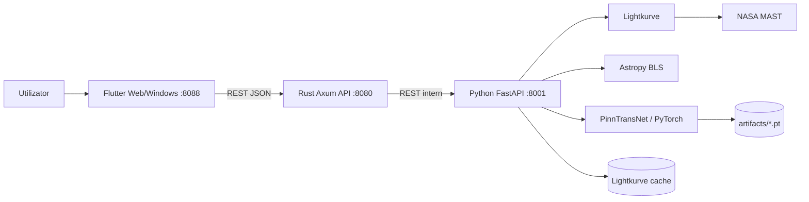
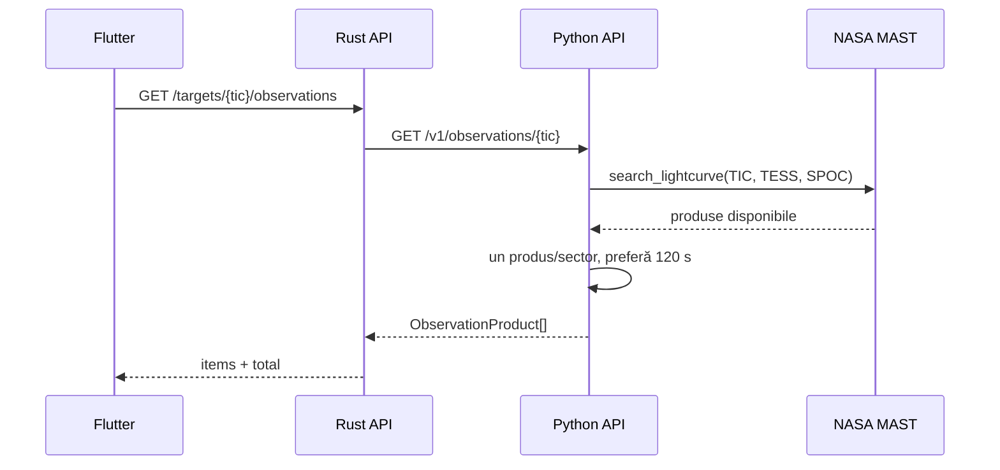
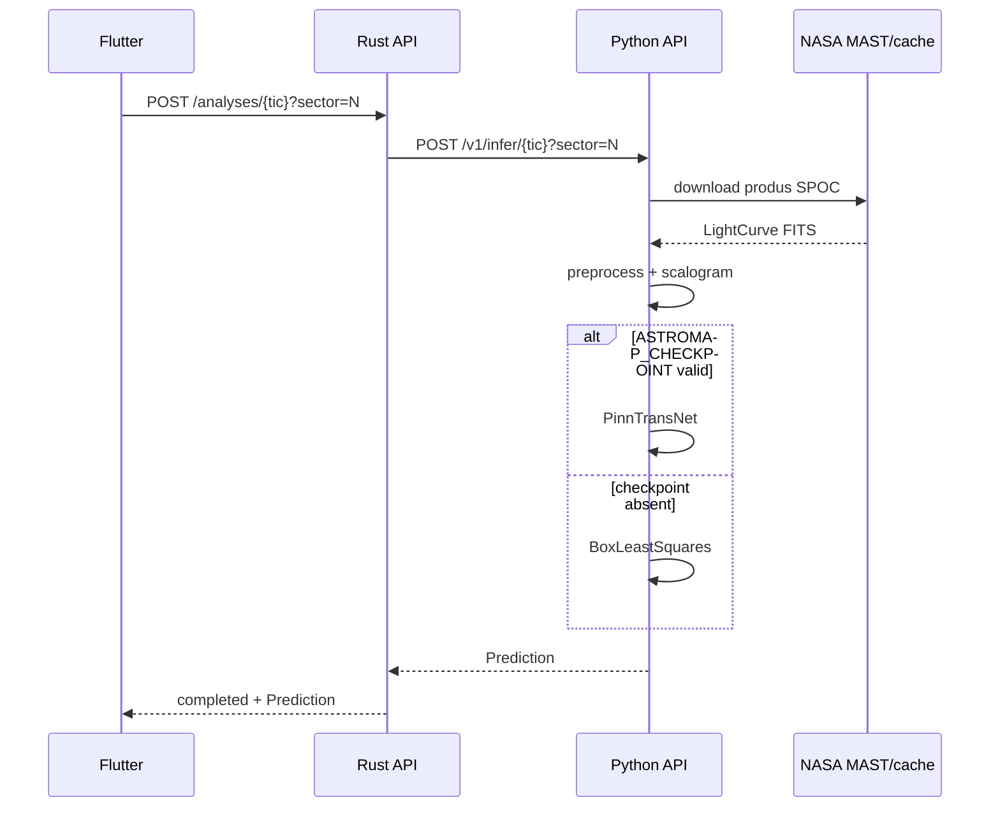

# Arhitectura sistemului

## 1. Principii

Arhitectura separă responsabilitățile pe ecosisteme:

- Python controlează adevărul științific și toate operațiile dependente de FITS, MAST, Astropy și PyTorch.
- Rust controlează suprafața HTTP publică, validarea cererilor și integrarea serviciilor.
- Flutter controlează prezentarea și interacțiunea utilizatorului.

Această separare previne duplicarea algoritmilor și permite înlocuirea interfeței ori a gateway-ului fără modificarea metodei științifice.

## 2. Diagrama componentelor



## 3. Componente și ownership

### 3.1 Serviciul Python

Director: [`python/src/astromap/`](../python/src/astromap/)

| Modul | Responsabilitate |
|---|---|
| `mast.py` | inventar SPOC, selecție produs, download și proveniență |
| `pipeline.py` | validare, quality mask, detrending, normalizare, resampling și scalogramă |
| `model.py` | arhitectura dual-domain și `physics_loss` |
| `inference.py` | alegerea BLS/model, serializarea predicției |
| `api.py` | endpoint-uri interne și încărcarea checkpoint-ului |
| `training.py` | smoke training determinist |
| `reporting.py` | raport HTML imprimabil |

Serviciul este intenționat stateless la nivel API. Starea persistentă actuală este cache-ul Lightkurve și, opțional, fișierul checkpoint.

### 3.2 Gateway-ul Rust

Director: [`apps/api-rust/`](../apps/api-rust/)

Responsabilități:

- catalogul public minimal de ținte;
- căutare spațială cu distanță unghiulară;
- validarea TIC ID, coordonate, rază și sector;
- proxy pentru inventarul observațiilor și inferență;
- timeout de 120 s pentru operațiile care pot descărca date;
- maparea erorilor într-un contract public stabil;
- CORS și HTTP tracing.

Gateway-ul nu parsează FITS, nu calculează BLS și nu încarcă PyTorch.

### 3.3 Clientul Flutter

Director: [`apps/client-flutter/`](../apps/client-flutter/)

Responsabilități:

- încărcarea catalogului;
- alegerea unei ținte și interogarea sectoarelor reale;
- selectarea produsului SPOC preferat;
- inițierea analizei sincron;
- stări loading/error/offline/result;
- proiecție ICRS simplificată și grafic fotometric;
- afișarea metodei și provenienței.

`models.dart` și `api_client.dart` trebuie menținute sincron cu JSON-ul public. UI-ul nu trebuie să deducă ori să recalculeze parametri astrofizici.

## 4. Fluxul de inventariere a observațiilor



`list_tess_observations()` are cache în proces, cu maximum 128 TIC IDs. Cache-ul se pierde la restart. Produsele cu mai multe cadențe în același sector sunt reduse la cel mai apropiat de 120 s.

## 5. Fluxul de analiză



Analiza este sincronă și idempotentă din perspectiva contractului. Prima descărcare poate dura mai mult; clientul trebuie să păstreze starea loading și să nu emită cereri duplicate prin click repetat.

## 6. Configurarea checkpoint-ului

La prima accesare a engine-ului, `python/src/astromap/api.py` citește `ASTROMAP_CHECKPOINT`:

- absent/gol: `InferenceEngine` folosește BLS;
- cale existentă: încarcă `state_dict` PyTorch și folosește modelul;
- cale configurată, dar inexistentă: serviciul ridică eroare și nu cade silențios pe BLS.

Engine-ul este cache-uit prin `lru_cache(maxsize=1)`. Schimbarea variabilei necesită restartul procesului Python.

## 7. Date și cache

### Date tranzitorii

- rezultatul MAST SearchResult;
- seriile NumPy din memorie;
- scalograma 32x512;
- răspunsul JSON downsampled la fiecare al patrulea punct.

### Date locale persistente

- cache-ul Lightkurve din home-ul utilizatorului/containerului;
- checkpoint-uri și rapoarte sub `artifacts/`;
- build-urile Rust/Flutter, ignorate de Git.

În Compose, `artifacts/` este montat read-only în serviciul Python. Cache-ul MAST nu are încă volum dedicat, deci se pierde la recrearea containerului.

## 8. Deployment local și containerizat

### Local

```text
Browser -> 127.0.0.1:8088 -> 127.0.0.1:8080 -> 127.0.0.1:8001 -> MAST
```

### Docker Compose

```text
Browser -> localhost:8088 (Nginx)
Browser -> localhost:8080 (Rust)
Rust -> inference:8001 (Docker DNS)
Python -> Internet/MAST
```

Flutter primește URL-ul API la build prin `--dart-define=ASTROMAP_API_URL=...`. Este o valoare compile-time; schimbarea ei necesită rebuild.

## 9. Constrângeri arhitecturale

- păstrează endpoint-urile Python interne, neexpuse direct utilizatorului în producție;
- nu servi fișiere FITS mari prin JSON;
- nu adăuga logică de model în Rust sau Dart;
- nu încărca checkpoint-ul pentru fiecare cerere;
- nu transforma lipsa datelor MAST în semnal sintetic;
- nu ascunde metoda care a produs scorul;
- orice viitor job queue trebuie să păstreze aceeași proveniență și idempotency key.

## 10. Arhitectura țintă, neimplementată

Planul extins prevede PostgreSQL/PostGIS, Redis, object storage, job workers și model registry. Acestea nu fac parte din runtime-ul actual. Orice implementare trebuie introdusă incremental, cu migrare de contract și teste end-to-end, nu doar adăugată în diagrame.